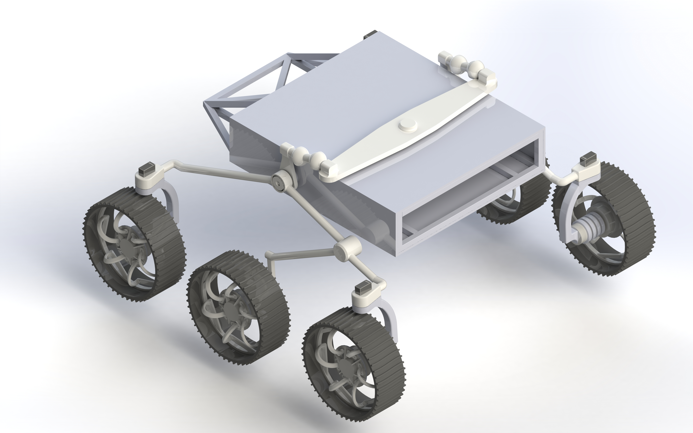
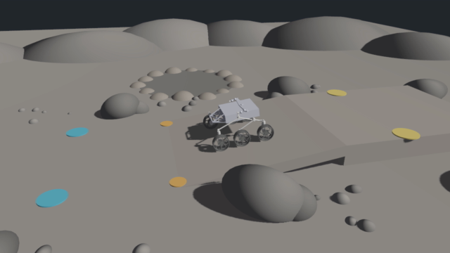
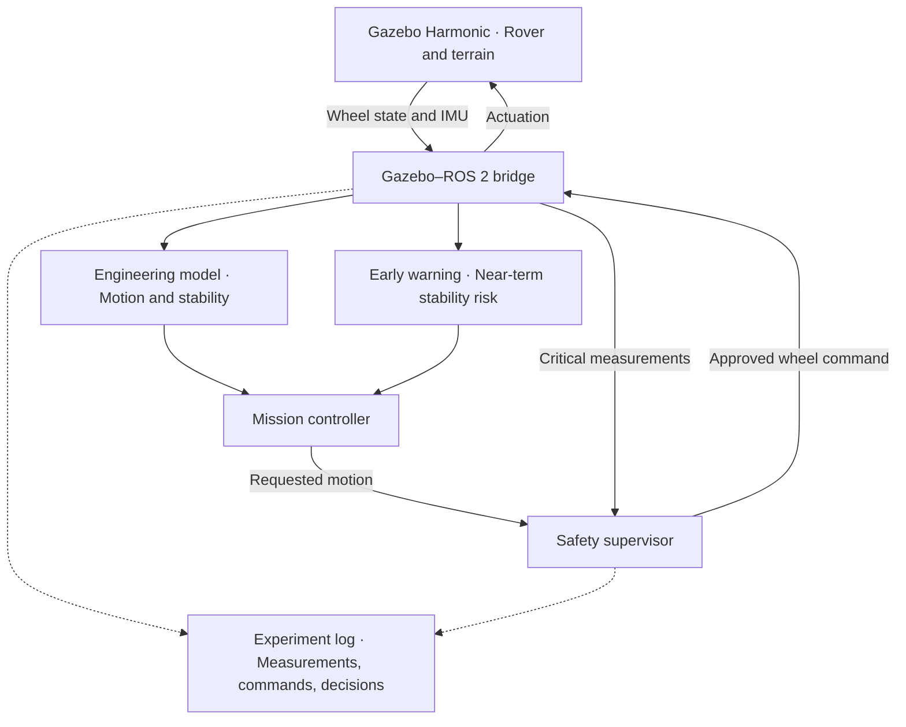
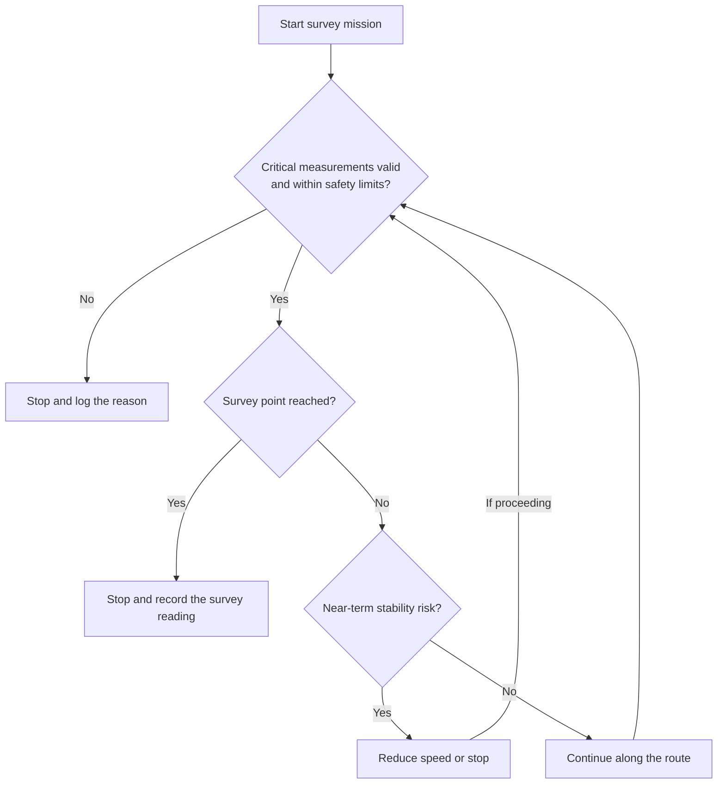

# AstroQuark — Lunar Rover Simulation

**A six-wheel Rocker–Bogie rover for simulated lunar exploration.**

This project connects mechanical design, vehicle dynamics, and robot control to answer a practical question: **Can a rover reach a survey point on uneven terrain while recognizing when to slow down or stop?**

The first mission follows a predefined route in Gazebo Harmonic. It combines wheel and body measurements with a kinematic model of straight-line motion, then records commands and telemetry.



## Demo video

[](AstroQuark_Lunar_Demo.mp4)

[Watch the 30-second demo](AstroQuark_Lunar_Demo.mp4)

## Prototype status

| Capability | Status |
| --- | --- |
| Mechanical model | A CAD assembly runs in Gazebo as URDF/SDF. Wheel joint axes and collision geometry were refined, and all six wheels supported the rover on flat terrain. |
| Drive and stop | A Python script sends a wheel-speed command and then a stop command through Gazebo Transport. |
| Motion measurement | Python reads the rover’s position before and after a drive, calculates horizontal displacement, and records it in CSV. |
| Integrated demo | ROS 2 connects wheel commands, joint readings, the body IMU and Gazebo pose. AstroQuark climbs a lunar ramp, slows near the goal and stops automatically. |

## Run the demo

From Ubuntu 24.04 with ROS 2 Jazzy, Gazebo Harmonic and `ros_gz_bridge` installed, run these commands from the project root:

```bash
source /opt/ros/jazzy/setup.bash
python3 scripts/run_astroquark_demo.py
```

On Windows with those tools installed in WSL, open [AstroQuark Demo.bat](rover_description/AstroQuark%20Demo.bat).

- [Engineering report](AstroQuark_Engineering_Report.pdf)
- [Speed, pitch and distance at 1.8 rad/s](demo_results/astroquark_run.svg)

- [Excel run summary](demo_results/AstroQuark_Run_1.8.xlsx)
- [Recorded telemetry](demo_results/astroquark_run.csv) and [verification](demo_results/verification.json)

## Target system architecture

ROS 2 will carry commands and measurements between the simulator, engineering model, and mission software. The safety layer will be able to override a mission command when a direct hazard or missing critical measurement requires a stop.



## Engineering model

The model connects wheel commands to vehicle motion and wheel contact to stability. Each prediction has a measurement that can be used to check it.

| Question | Model | Evidence |
| --- | --- | --- |
| How far should the rover move? | Estimate straight-line speed with `v = r × ω` under rolling without slip, then integrate speed over time. | Wheel angular velocity and rover position against simulation time. |
| How fast should it turn? | Estimate yaw rate from the difference in left and right ground speeds using an effective track width. Side slip limits the approximation. | Heading change during left and right turns. |
| How much stability margin remains? | Use suspension geometry and active wheel contacts to estimate the support region. In a quasi-static model, compare it with the projection of the center of mass along gravity. | Suspension angles, body tilt, and simulator contact data. |
| How does terrain affect traction? | Estimate the effect of slope and friction on available traction and required wheel torque. | Compare a flat reference run with a simplified lunar slope or obstacle. |

Gazebo’s reference pose and contact data will support analysis and training labels. The planned predictor will use measurements the rover can receive during operation, such as tilt, angular rate, and wheel state.

## Mission and safety decisions

The first mission uses a predefined route to one survey point. The proposed logic checks for an immediate hazard first, then uses the predictor to respond to developing risk. A reduced-speed decision triggers another assessment as fresh measurements arrive.



## Development milestones

| Milestone | Deliverable |
| --- | --- |
| ROS 2 integration | A ROS 2 command moves and stops the simulated rover, and a Gazebo measurement is visible in ROS 2. |
| Sensing and logging | IMU and wheel-state readings are recorded with simulation timestamps and command values. |
| Motion and terrain modeling | A model estimates forward motion, turning, and stability on flat ground and on a simplified lunar slope or obstacle. |
| Mission automation and early warning | The rover completes the survey route or takes a documented safety action. A lightweight predictor can request a slowdown or stop. |
| Embedded integration | After simulation integration, connect one physical IMU or motor-control module through the same measurement or command interface, subject to hardware availability. |

The simulation scope is one route with simplified gravity and contact conditions. Detailed lunar soil, map-based navigation, and a full physical rover are potential extensions.

## Project Status

Development is ongoing.
